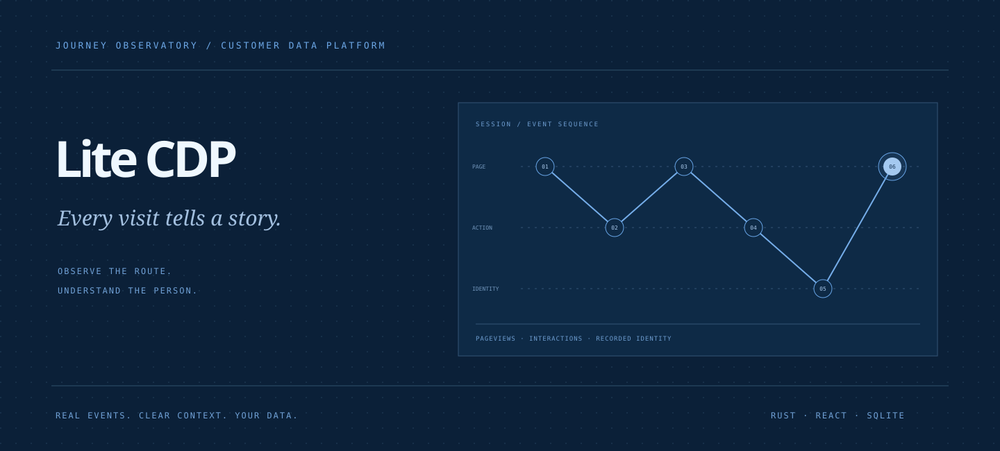
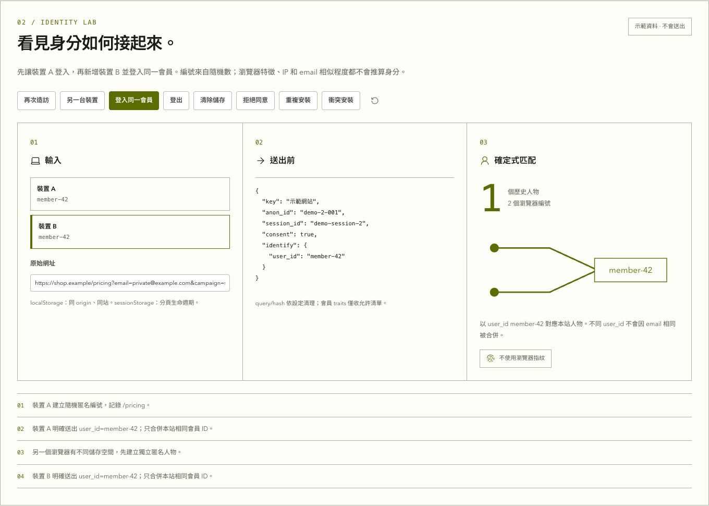
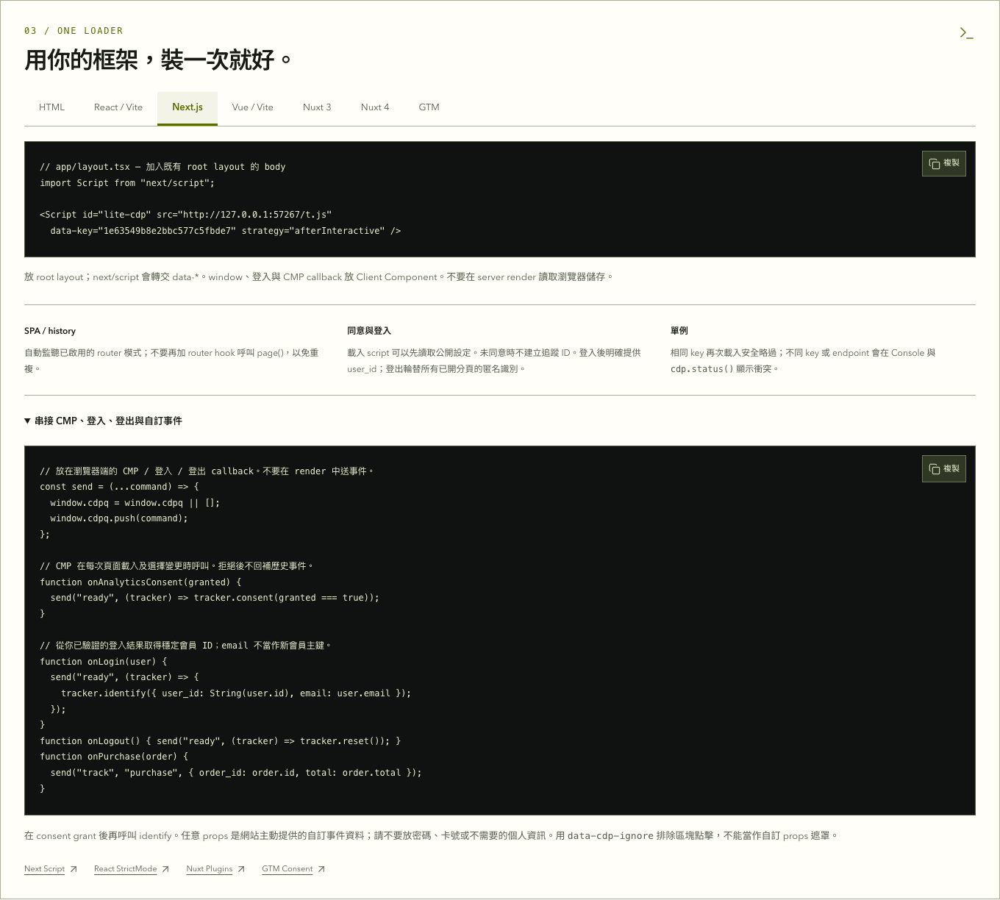
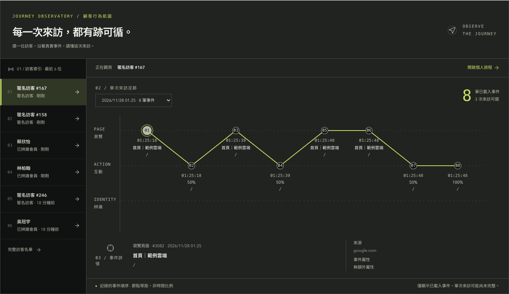
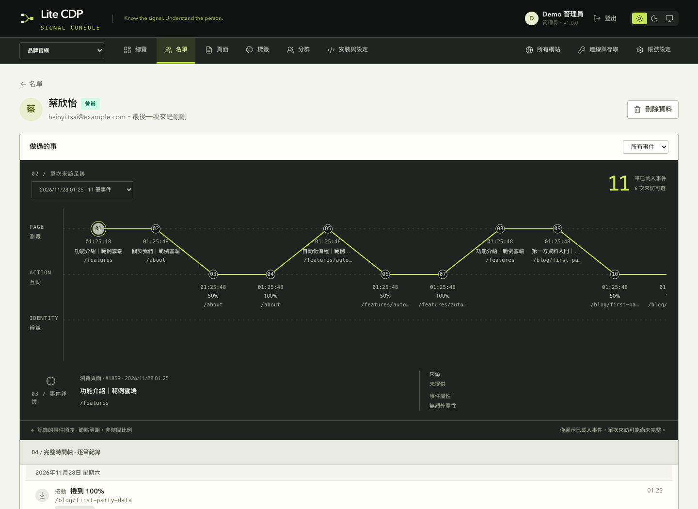
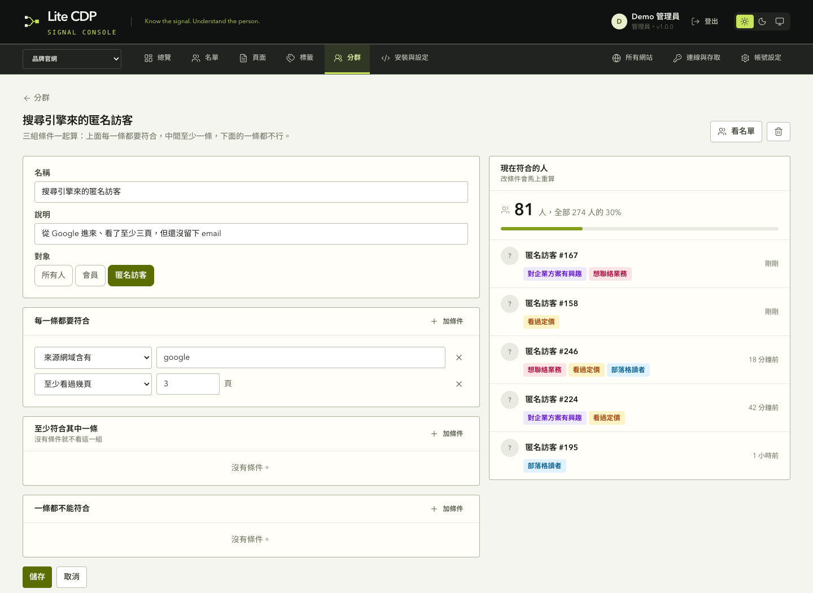
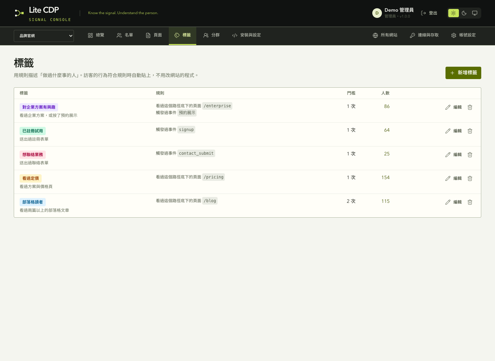
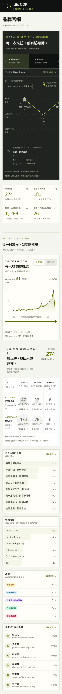
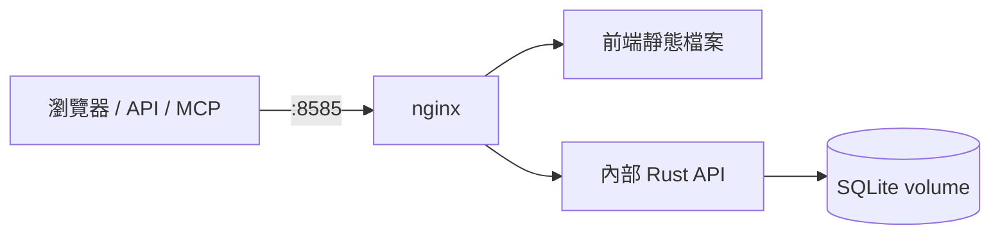
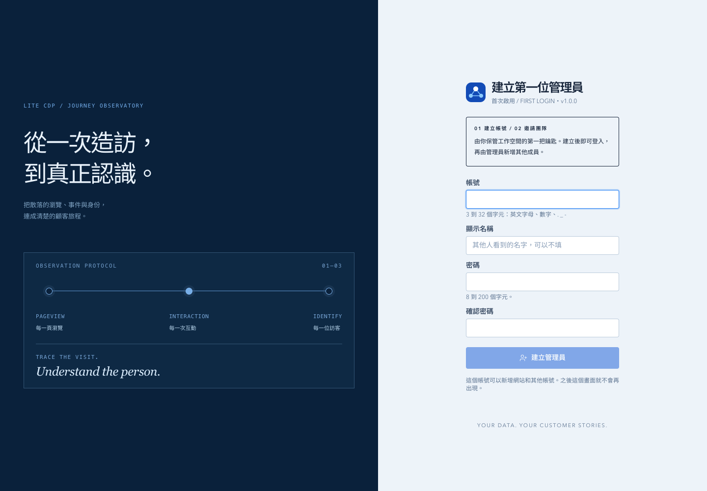

<p align="center">
  
</p>

<p align="center">
  <a href="https://github.com/NatLee/lite-cdp/actions/workflows/ci.yml"></a>
  
  
  
  
</p>

流量分析工具會告訴你「這個月有幾個人來」，但行銷和業務想知道的通常是另一件事：**哪些人**看了價格頁三次卻沒留資料、上個月買過咖啡豆的人最近有沒有再回來、放進購物車沒結帳的是誰。

Lite CDP 是一個自己架的小型顧客資料平台。每個網站有自己的採集設定，決定何時可以記錄、收哪些資料。登入後由網站明確傳入穩定的 `user_id`，把該瀏覽器的匿名紀錄接到會員身上；不以 IP、瀏覽器特徵或 LLM 猜測身分。接著用規則幫人貼標籤，再用標籤和條件組出名單，匯出成 CSV 拿去寄信或投廣告。

一份 Docker Compose 啟動 nginx 前端與內部 Rust API，資料存於 SQLite。資料留在你自己的機器上。

## 先看清楚，再開始採集

Signal Console 用石墨黑、暖白與橄欖色呈現三件事：**送進來什麼、為什麼認為是同一個人、哪些事件真的收到**。以下畫面來自隔離的虛構 demo。封面是可編輯的 [SVG](docs/images/cover.svg)，兩條路徑只在明確相同會員 ID 時合流。

### 1. 試著登入兩台裝置

互動模擬器展示再次造訪、跨裝置登入、登出、清除儲存、拒絕同意與重複安裝。左側改輸入，中間看送出前的 payload，右側看身分匹配。所有操作都留在本機示範，不寫入 analytics。



### 2. 選擇採集範圍，依框架安裝

設定同意、DNT、自動瀏覽／點擊／捲動、SPA 模式、query 與來源清理、忽略區塊、traits 白名單和身分政策。可直接選最少採集設定；必須按儲存才會套用。HTML、React/Vite、Next.js、Vue/Vite、Nuxt 3/4 與 GTM 都有範例與生命週期說明。



### 3. 看實際回執，再追蹤旅程

建立 15 分鐘的安裝測試碼，在被追蹤網站載入測試 snippet，回來取得 collector 回執。它會顯示清理後的事件、來源和身分簽署狀態，**不建立人物或增加瀏覽數**。正式事件進入旅程後，可按 session 與事件種類閱讀每一步。


[追蹤與整合契約](docs/tracking.md) · [驗證與重拍方式](docs/signal-console-verification.md)

## 功能

- **一行程式碼就能裝**：可設定自動記錄瀏覽、點擊和捲動深度，支援 history、hash 與手動 SPA。追蹤器不建立 cookie，不載入第三方程式。
- **把匿名訪客認出來**：以網站內穩定的 `user_id` 連接多個裝置；舊版 email-only identify 保持相容且可關閉。不同會員 ID 不會因共用 email 而合併。
- **顧客行為航圖**：從最近出現的訪客選一人，再選一次來訪。瀏覽、互動、辨識分列成事件路徑，點節點查看時間、頁面、來源與屬性。
- **每個人的完整時間軸**：看了哪些頁、從哪裡來、用什麼裝置、觸發過哪些事件，一次工作階段一段。
- **標籤**：用規則描述「做過什麼事的人」（看過某個路徑底下的頁面、網址或標題含某些字、觸發過某個事件），可以設定要符合幾次才算。規則改了，舊資料會跟著重算。
- **分群**：用標籤、來源、email、最近有沒有來、看過幾頁組出一份名單，分成「全部都要符合／至少符合一個／不能符合」三組。一邊調條件一邊看符合幾個人，存起來之後每次打開都是當下的結果。
- **回訪地圖**：把已辨識會員／匿名訪客，按最後造訪時間分成近期活躍、回訪降溫、久未回訪。點任一座標就能查看那一群人。
- **每日訊號探索**：切換瀏覽頁數／每日訪客，點圖表或拖動日期軸查看當天數據；鍵盤也能操作。
- **CSV 匯出**：名單和分群都可以匯出，包含身分、活躍時間、搜尋、標籤與分群條件。
- **多個網站、多個帳號**：每個網站有自己的追蹤金鑰和允許的來源。成員只看得到指定給他的網站。
- **隱私**：不存訪客的 IP；可以設定事件只留幾天；可以整個刪掉某個人；可以尊重瀏覽器的「不要追蹤」。
- **帳號**：第一個打開網頁的人建立管理員，沒有預設帳號，也沒有預設密碼。密碼用 Argon2 雜湊，登入是 HttpOnly cookie。
- 淺色和深色模式。

## 畫面與工作流程

以石墨、暖白與單一橄欖重點色構成「Signal Console」：網站切換和功能導覽位於上方，保留完整寬度給名單、身份與行為時間軸。所有數字來自 API；截圖使用內建虛構 demo 資料。

### 從一次來訪開始

總覽先呈現最近出現的六位訪客。選擇一位後，讀取最近 50 筆事件，以已記錄的 `session_id` 分組；沒有來訪識別的事件各自呈現。每次來訪按時間與事件編號排列，節點等距表示先後順序，不是時間比例。資料可能跨多頁，因此畫面明示單次來訪可能尚未完整。

### 從足跡到身份

航圖下方以六個座標呈現目前身分 × 最後造訪：7 天內、7–30 天、超過 30 天。每人只在一格，圓面積代表人數、百分比以網站全部訪客為分母。點格子進入同樣條件的名單，也能直接匯出 CSV。這是目前的分布，不是轉換率或歷史遷移。

每日曲線可切換瀏覽頁數與訪客，點選或用日期滑桿查看一天的兩項數值。每日訪客按當天去重，跨日數字不當成全期獨立人數加總。

### 名單與個人旅程

搜尋、標籤、分群與最近活躍篩選共同整理名單；個人頁的寬幅航圖可切換來訪與事件種類，往下保留逐筆紀錄、載入更早事件、身份、標籤、裝置和來源。

### 規則與分群

標籤按事件規則自動計算。分群編輯器保留三組條件，以及隨條件更新的人數與名單預覽。

<details>
<summary>完整總覽、標籤、安裝、其他功能、登入、深色與手機畫面</summary>













</details>

## 快速開始

```bash
git clone https://github.com/NatLee/lite-cdp.git
cd lite-cdp
docker compose up -d --build
```

只有 nginx 發布 `8585`；前端資產由 nginx 提供，API、OAuth 與 MCP 轉送至內部 `lite-cdp`。資料仍保存於原本的 SQLite volume。



瀏覽器網址須與 `ACCESS_PUBLIC_URL` 完全相同；預設使用 `http://127.0.0.1:8585`。正式 HTTPS 網域、既有 URL 變數、代理路由與升級方式見 [nginx 部署說明](docs/nginx-deployment.md)。

打開 <http://127.0.0.1:8585>，第一次會請你建立管理員帳號。接著：

1. 到「所有網站」新增一個網站。
2. 「安裝與設定」頁有一行追蹤程式碼，貼進網站每一頁的 `<head>`：

   ```html
   <script async src="http://127.0.0.1:8585/t.js" data-key="你的追蹤金鑰"></script>
   ```

3. 在「採集設定」選擇範圍並儲存。既有網站與省略設定的 API 呼叫維持舊版行為；新部署建議使用「最少採集設定」，並接上下面的同意回呼。
4. 先用安裝測試回執確認來源與事件；移除測試碼後，正式瀏覽才會進入名單。

想先看有資料的樣子，可以在**空的**資料庫裡建立範例帳號、網站和訪客（密碼會印在畫面上）：

```bash
docker compose run --rm lite-cdp lite-cdp demo
```

忘記密碼的時候：

```bash
docker compose exec lite-cdp lite-cdp reset-password <帳號>
```

## 追蹤程式碼

安裝一次 loader。設定載入完成後再接上你的 CMP 和登入系統；**同意決策由網站保存，並在每次載入時重新提供**。

```js
function send(command, ...args) {
  (window.cdpq = window.cdpq || []).push([command, ...args]);
}

// 接在網站自己的 CMP 更新回呼；required consent 期間不建立 ID 或緩存事件。
function onAnalyticsConsent(granted) {
  send("ready", tracker => tracker.consent(granted));
}

// 同意後、登入成功時呼叫；user.id 必須是本站穩定會員 ID。
function onLogin(user) {
  send("ready", tracker => tracker.identify({
    user_id: String(user.id), email: user.email, name: user.name, plan: user.plan
  }));
}

function onLogout() {
  send("ready", tracker => tracker.reset());
}

// 只在實際動作發生時呼叫，不能放在每次 render 的函式裡。
send("track", "add_to_cart", { sku: "A-1001", price: 1280 });
```

`user_id` 是明確主張的身分，不是訪客驗證；可啟用伺服器 HMAC 簽署會員 ID。舊的 `identify({ email })` 仍可使用，但不會把不同 `user_id` 的人物合併。`name`、`account` 是基本欄位，其他平面欄位依 traits 白名單採集。詳細的資料界線、登出、跨分頁行為、簽署方法與所有框架範例見 [追蹤契約](docs/tracking.md)。

| script 屬性 | 說明 |
|---|---|
| `data-key` | 必填，公開的網站追蹤金鑰 |
| `data-respect-dnt="true"` | 額外限制：尊重瀏覽器 DNT |
| `data-auto-page="false"` | 停用初始與自動 route pageview；可手動 `page()` |
| `data-auto-click="false"`、`data-auto-scroll="false"` | 額外停用自動點擊／捲動 |
| `data-spa-mode="history\|hash\|manual"` | 選擇 router 生命週期；手動模式勿再同時使用自動 route |
| `data-endpoint="https://…/collect"` | 自訂 collector；公開設定仍從 script 的 origin 讀取 |
| `data-test-token="…"` | 安裝回執模式；過期或錯站會拒收，不會轉成正式資料 |

`data-cdp-ignore` 排除區塊點擊，`data-cdp-click="add_to_cart"` 命名點擊。關閉點擊文字時伺服器將名稱統一為 `click`。手動事件 `props` 由網站提供，URL 清理不會遞迴遮罩 props 中的文字。可用 `cdp.status()` 或 `cdp:diagnostic` 事件查看重複安裝、衝突、傳輸失敗與丟棄數。

### 放到網路上

前面放一個有 HTTPS 的反向代理（Caddy、nginx…），然後設定：

- `CDP_PUBLIC_URL`：外部看到的網址。「安裝與設定」頁的追蹤程式碼用它組，是 https 時登入 cookie 會加 `Secure`。
- `CDP_TRUST_PROXY=true`：流量限制是照 IP 算的，這樣才看得到訪客真正的 IP。
- 每個網站的「允許的來源」填上自己的網址。追蹤金鑰本來就寫在網頁原始碼裡，誰都看得到；填了之後，別的網站拿你的金鑰也送不進資料。

## 隱私

Lite CDP 存的是個人資料，請照你所在地的法規告知訪客並取得同意。它自己做了這幾件事：

- **不存 IP。** IP 只在記憶體裡用來限制流量。
- **不以 cookie 或指紋認人。** 追蹤器以 crypto 隨機編號存於 first-party `localStorage`，再依 site ID 隔離。不同 origin（含子網域）、裝置、無痕或清除儲存後都不會自動相認。登入相同 `user_id` 才能在同一 CDP 網站下連起來。管理台登入另外使用 HttpOnly cookie。
- **可以設定保留期限。** `CDP_RETENTION_DAYS=365` 每 6 小時清理一年以前的事件；預設不刪。
- **可以刪掉一個人。** 管理員在那個人的頁面按刪除，他的資料、事件和標籤會一起刪掉。
- **同意與 DNT。** 每站可要求同意、尊重 DNT；同意撤回會丟棄佇列與識別碼並通知同 origin 的已開分頁。已收到的歷史資料另以刪除人物功能處理。
- **按站縮減資料。** query 可移除或保留白名單，referrer 可只收 origin，traits 可明確列允許欄位。
- 認得出來的爬蟲不會被記錄。

## 設定

都是環境變數，全部可以不設。用 docker compose 時寫在同一個資料夾的 `.env`（[.env.example](.env.example) 有範例）。

| 變數 | 預設 | 說明 |
|---|---|---|
| `CDP_PORT` | `8585` | docker compose 對外的 port |
| `CDP_PUBLIC_URL` | | 外部看到的網址，例如 `https://cdp.example.com` |
| `CDP_COOKIE_SECURE` | 看 `CDP_PUBLIC_URL` | `true` / `false`，強制指定 cookie 要不要加 `Secure` |
| `CDP_TRUST_PROXY` | `false` | 前面有反向代理時設 `true`，訪客的 IP 改看 `X-Forwarded-For` |
| `CDP_RATE_LIMIT` | `600` | 同一個 IP 一分鐘最多送幾次資料，`0` 是不限制 |
| `CDP_RETENTION_DAYS` | `0` | 事件留幾天，過期自動刪除；`0` 是不刪 |
| `CDP_BIND` | `0.0.0.0:8585` | 伺服器聽的位址 |
| `CDP_DATA_DIR` | `data`（映像檔裡是 `/app/data`） | 放 SQLite 資料庫的資料夾 |
| `CDP_DATABASE_PATH` | `<CDP_DATA_DIR>/lite-cdp.db` | 資料庫檔案 |
| `CDP_STATIC_DIR` | `src/web/dist`（映像檔裡是 `/app/web`） | 前端檔案的位置 |
| `CDP_DEMO_PASSWORD` | 隨機產生 | `demo` 指令建立的範例帳號要用的密碼 |

資料都在 `lite-cdp-data` 這個 volume 的 SQLite 檔案裡，備份那個檔案就好。

## 適合和不適合

適合：一個或幾個網站、想知道「誰」做了什麼、想自己保管資料的團隊。只要一台小機器和一個 SQLite 檔案。

不適合：需要即時串接廣告平台、跨 App 和線下資料整合、或每天上億筆事件的情境。那是大型 CDP 的工作。

## 開發

需要 Rust（stable）、Node 24、pnpm。開發固定使用 `http://127.0.0.1:5173`；後端的 `ACCESS_PUBLIC_URL` 必須與前端相同。若另設 `CDP_PUBLIC_URL`，也必須同 origin。

```bash
# 後端：http://127.0.0.1:8585
cd src/api && ACCESS_PUBLIC_URL=http://127.0.0.1:5173 cargo run

# 前端：http://127.0.0.1:5173，/api、/collect、/tracker-config 和 /t.js 會轉給後端
cd src/web && pnpm install && pnpm dev --host 127.0.0.1 --port 5173 --strictPort
```

```bash
cd src/api && cargo fmt --check && cargo clippy --all-targets -- -D warnings && cargo test
cd src/web && pnpm test && pnpm build
bash docs/smoke-test.sh http://127.0.0.1:8585   # 對一個空的執行個體跑一輪
```

API 和收資料的格式在 [docs/api.md](docs/api.md)。

## 設計與驗證

[產業介面設計與驗證](docs/industry-design.md) 說明這次的專用元件與真實資料互動；[視覺分析設計與驗證](docs/visual-insights.md) 說明分布定義與驗證；[原版型紀錄](docs/design.md) 說明版型、響應式、後端修正及驗證範圍。封面是可編輯的 [SVG](docs/images/cover.svg)；應用畫面由 [擷取腳本](docs/capture-screenshots.py) 對隔離的 demo 執行個體重拍。

## 授權

[MIT](LICENSE) © Nat Lee

## 帳號綁定、OAuth、API 與 MCP

原生「連線與存取」可綁定 GitHub／Google、建立與撤銷金鑰、管理應用授權及核對真正用量。`reports:read` 只讀取站台與彙總報表；`people:read` 才能讀取個人事件、完整事件網址與屬性。建立金鑰預設不含個人事件，需另外勾選。 設定與協定見 [存取指南](docs/access.md)，本機真實操作見 [錄影](docs/images/access-workflow.webm) 與 [稽核截圖](docs/images/access-03-usage.png)。


## 首次登入與建立管理員

第一次開啟空白安裝時，首頁、登入頁和需要登入的頁面都會自動導向 `/first-login`。輸入 3–32 個英文字母、數字或 `. _ -` 的帳號、選填顯示名稱，以及 8–200 個字元的密碼與確認密碼，按「建立管理員」後即以新管理員身份進入工作空間。密碼不一致時不會送出請求。

這個頁面只用來建立第一位管理員。有帳號的安裝會改顯示 `/login`；其他成員可由管理員新增，或依註冊設定自行申請。若另一位管理員已先完成設定，舊頁面會自動轉成登入。透過 OAuth 登入的合法本站授權流程會在建立帳號後接續進行。

Docker 對外網址請維持 `CDP_PUBLIC_URL` 與 `ACCESS_PUBLIC_URL` 同源。操作與實際瀏覽器驗證見 [首次登入驗證紀錄](docs/first-login-verification.md)。



## 成員註冊與審核

`/first-login` 只用來建立第一位管理員。後續成員可從登入頁的「註冊帳號」進入 `/register`；新安裝預設關閉註冊。管理員可在「設定 → 註冊與審核」選擇關閉、審核後開通，或開放立即註冊。關閉只停止新申請，仍可處理已送出的申請。

密碼註冊包含確認密碼；帳號為 3–64 個英數字或 `. _ -`，密碼為 12–256 個字元，顯示名稱選填、最多 100 個字元。設定 Google／GitHub 後，註冊頁只顯示可用的供應商。第三方註冊會建立一般成員，不會依電子郵件合併既有帳號；原有第三方「登入」入口仍只登入已綁定的帳號。

待審核或已拒絕的帳號無法進入工作區，也無法使用 API／MCP。管理員可依狀態分頁查看申請、核准或填寫原因後拒絕；下方處理紀錄保留申請、審核及註冊設定變更的時間與操作者。既有帳號的停用／啟用不會取代註冊審核。

[註冊與審核驗證紀錄](docs/registration-verification.md) 提供測試範圍與實際瀏覽器截圖。

實際 Chrome 畫面：[註冊頁・桌面淺色](docs/images/registration-register-desktop-light.png) · [管理員審核・手機深色](docs/images/registration-review-mobile-dark.png)。完整桌面／手機、淺色／深色共八張截圖見驗證紀錄。 可在建置後執行 `python docs/verify-registration.py --binary /path/to/binary` 重現完整流程；需安裝 Python Playwright 與 Google Chrome。
