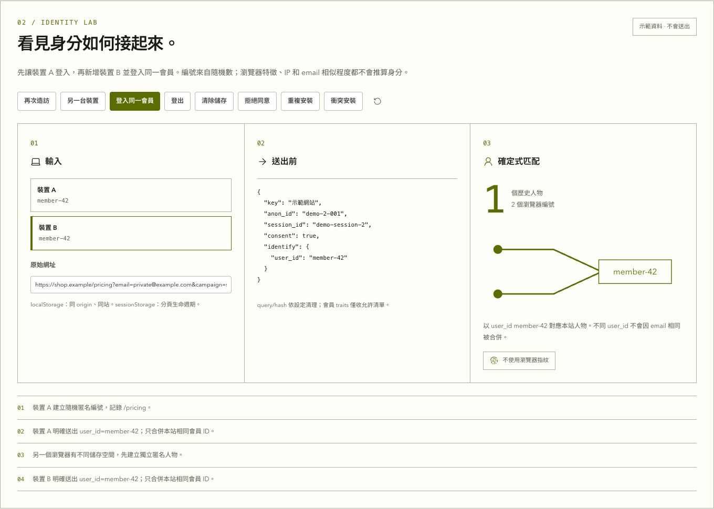
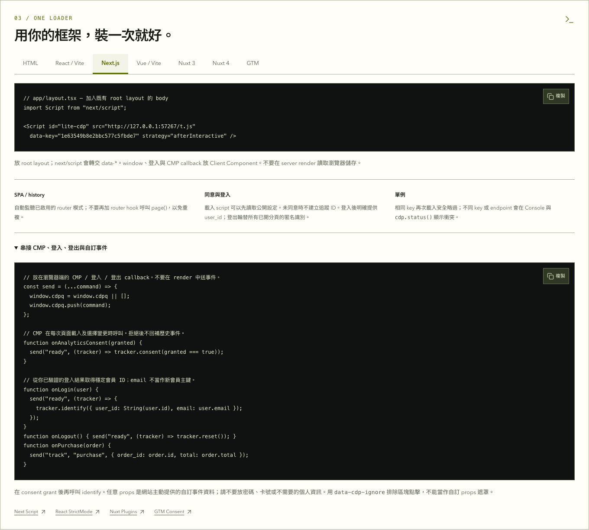
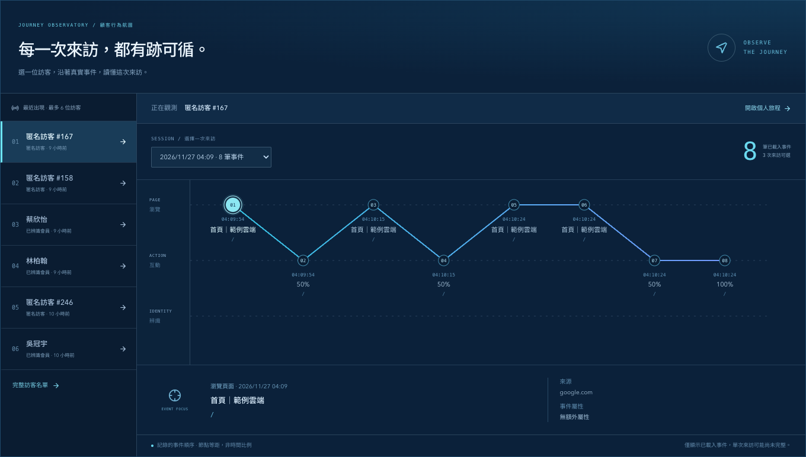

# Tracking and identity contract

Signal Console makes the ingestion policy visible. A browser identifier is a random first-party value. A person is joined across browsers only through an explicit, site-scoped identity claim. No fingerprint, IP matching, probabilistic algorithm, or language model is used.

## Illustrated walkthrough

These are actual Chrome captures of the current application using a disposable, fictitious demo. The identity lab is a local simulator; its example payloads do not write analytics. The journey image shows recorded demo events from the real API.

### 1. Try the explicit identity rule

Open **安裝與設定** and use the identity lab. Choose **登入同一會員**, switch to **另一台裝置**, then identify the same member again. Compare the example payload and matching result: two browsers join only after the same explicit member ID. Try logout, storage clearing or denied consent to see the separate outcomes.



### 2. Save the collection policy and install once

Choose the fields and consent policy, then press **儲存採集設定**. Select your framework; the image below shows Next.js placement and the CMP/login/logout callbacks. Install one loader at the documented application root. Connect consent first, then identify the authenticated member after a grant. The recipes below cover HTML, React, Next.js, Vue, Nuxt and GTM.



Before production collection, follow [Real installation receipt](#real-installation-receipt): create a test code, load it on the tracked site and check the accepted payload. A test code alone is not a received request. The screenshots here show the integration teaching and journey, not a received test receipt.

### 3. Read a recorded visit

After removing test mode, open the overview, select a recent visitor and choose a visit. Click a node to inspect its event details. Events are grouped by recorded session ID; equally spaced nodes indicate order, not elapsed time. The page states that the loaded visit may be incomplete; use the person's timeline to load earlier events.



For HTTP clients and policy field names, use the [API reference](api.md). The following sections define compatibility, consent, identity ordering and collection limits.

## Installation and compatibility

Use one loader per document with one site key and collector endpoint. The same loader loaded twice reuses the existing instance without another pageview or listener. A different key or endpoint raises `conflicting_installation` and keeps the original destination. This is not a multi-site SDK within a single document.

Existing sites and `POST /api/sites` calls that omit `collection_policy` retain legacy defaults: automatic page/click/scroll, history routing, no required consent, no DNT enforcement, full referrer, query kept, all supported flat traits, and legacy email identity. Hashes and URL credentials are always removed. The UI's **最少採集設定** changes the draft to required consent, DNT, pageviews, no click/scroll, query stripped, origin-only referrer, no click text, and an empty trait allowlist; it only takes effect after Save. Review existing sites deliberately before switching them.

The additive `0005_collection_identity.sql` and `0006_identity_order.sql` migrations preserve old people, devices, events, and site keys. It backfills `received_at` from the historical timestamp and initializes private identity secrets. Legacy event payloads without IDs or client time remain accepted. `/api/v1` operation names, scopes and projections, MCP tools, access-kit, auth, registration, and deployment origins are unchanged.

## The identity algorithm

1. Fetch the public `GET /tracker-config/{key}`. It contains site namespace, active state, and collection policy. It never contains the signing secret. Configuration failure stops collection.
2. Evaluate active state, DNT and consent before creating tracking IDs or recording events. A public config request still occurs. A site’s own CMP persists consent and reapplies it on every page; this tracker does not supply a consent banner or remember a permanent grant.
3. Once allowed, generate 96 random bits using `crypto.getRandomValues`. Store the browser ID in `localStorage` under `cdp_site_{id}_anon_id`, and the session ID in `sessionStorage` under `cdp_site_{id}_session_id`. Blocked storage falls back to memory and reports `storage: "memory"`.
4. The first eligible site on an origin can claim an old `cdp_anon_id` using `cdp_legacy_claim`. Other site namespaces generate independent IDs. The old unscoped session is not migrated.
5. A browser initially belongs to an anonymous person. `identify({user_id: "member-42"})` joins it to the matching member **within that CDP site**. An anonymous person’s recorded history moves to that member. Already identified account switches redirect the browser’s future events; the previous member's history stays attached to that member.
6. `user_id` is case-sensitive, trimmed, at most 128 bytes, with no control characters. Use a stable internal account key, never a display name. Distinct `user_id` values never merge because email matches.
7. Legacy `identify({email})` matches lowercased email among email-only people. The `legacy_email` switch can disable that path. A current email-only person can be upgraded to a stable ID when the supplied email agrees. An ID without that matching email creates/uses a separate stable subject instead of guessing an upgrade.
8. `reset()` flushes the current batch, rotates browser and session IDs, and broadcasts an epoch marker. Other tabs on the same origin/site discard stale queued identity and switch before the next event. `consent(false)` discards pending data, removes tracking IDs and broadcasts revocation. Neither action deletes history already received by the collector.

Storage is origin-scoped, so `www.example.com` and `shop.example.com` do not share anonymous IDs. Different devices, private windows, browser profiles and cleared storage also remain separate. They can join only after sending the same explicit member ID to the **same site key**. Separate CDP sites stay separate. This tracker does not establish a shared cookie domain or cross-domain link decoration. Session IDs follow the browser tab’s sessionStorage lifetime; there is no 30-minute inactivity rule. Browsers can copy sessionStorage into a tab opened with an opener.

## Consent and lifecycle

```js
function send(command, ...args) {
  (window.cdpq = window.cdpq || []).push([command, ...args]);
}
function onConsentChanged(granted) {
  send("ready", tracker => tracker.consent(granted));
}
function onLogin(user) {
  send("ready", tracker => tracker.identify({
    user_id: String(user.id), email: user.email, name: user.name, plan: user.plan
  }));
}
function onLogout() {
  send("ready", tracker => tracker.reset());
}
```

Call consent before login, using the real saved CMP state. After a grant, repeat the current authenticated user's identify explicitly. `ready` waits for configuration. Commands submitted through either `cdpq.push` or the direct API while configuration is pending are held in a bounded, memory-only initialization queue (up to 200 commands); no tracking ID or event is created yet. Once policy resolves, commands run only if the resolved consent/DNT gate permits collection, otherwise they are discarded. Commands submitted while consent is known to be denied are immediately discarded and never backfilled. Configuration failure clears the initialization queue. With required consent, the collector independently requires `consent: true`; this flag is a client claim, not a consent audit record. DNT is honored both by the tracker and by the collector when the HTTP DNT header is supplied. Pause and configuration changes take effect on the next document load; the collector enforces current policy immediately, including rejecting a paused site.

## Framework recipes

Replace `https://cdp.example.com` and `SITE_KEY` with the generated values in the installation UI. All examples use the tracker’s history mode by default. Do not also call `page()` from a router hook unless switching to manual mode.

**HTML / React with Vite / Vue with Vite:** place the loader once in `index.html` `<head>`. Do not append it inside a component render or route component. React Strict Mode deliberately reruns Effects in development; application event callbacks should represent completed actions, rather than component mounting. [React Strict Mode](https://react.dev/reference/react/StrictMode).

```html
<script async src="https://cdp.example.com/t.js" data-key="SITE_KEY"></script>
```

**Next.js App Router:** use `next/script` once in the root layout. `afterInteractive` loads on the client after hydration begins. Call consent/login from a client component or authentication/CMP callback, never during server rendering. [Next Script](https://nextjs.org/docs/app/api-reference/components/script).

```tsx
import Script from "next/script";
export default function RootLayout({children}: {children: React.ReactNode}) {
  return <html><body>{children}
    <Script id="lite-cdp" src="https://cdp.example.com/t.js"
      data-key="SITE_KEY" strategy="afterInteractive" />
  </body></html>;
}
```

**Nuxt 3:** `plugins/lite-cdp.client.ts`. **Nuxt 4:** `app/plugins/lite-cdp.client.ts`. The `.client` suffix prevents server access to window/document. The mounted hook installs one root loader; no page component should reinstall it. [Nuxt 3 plugins](https://nuxt.com/docs/3.x/directory-structure/plugins), [Nuxt 4 plugins](https://nuxt.com/docs/4.x/directory-structure/app/plugins).

```ts
export default defineNuxtPlugin(nuxtApp => {
  nuxtApp.hook("app:mounted", () => {
    if (document.getElementById("lite-cdp")) return;
    const script = document.createElement("script");
    script.id = "lite-cdp";
    script.async = true;
    script.src = "https://cdp.example.com/t.js";
    script.dataset.key = "SITE_KEY";
    document.head.appendChild(script);
  });
});
```

**GTM:** create a Custom HTML tag containing the HTML snippet; choose Once per page and a trigger gated by your analytics consent decision. Google Consent Mode does not call `cdp.consent` automatically. Connect grant/revoke from your CMP using the lifecycle functions above; if the tag only loads after grant, call grant through `ready` once it is loaded. Do not also fire a duplicate pageview tag on History Change while history mode is enabled. [Google consent integration](https://developers.google.com/tag-platform/security/guides/consent).

**Manual routing:** set `data-spa-mode="manual" data-auto-page="false"`, then call `page()` once after a successful route and title update. For Vue Router, an application-level `afterEach` hook can do this; ignore navigation failures. For Next, use one client observer of pathname/search parameters and guard identical URLs. Manual mode avoids history wrapping but the application owns initial-page and route deduplication. Hash mode observes `hashchange`; hashes trigger new pageviews but are removed from transmitted URLs. [Vue Router navigation hooks](https://router.vuejs.org/guide/advanced/navigation-guards.html).

## Identity replay and ordering

The tracker gives every explicit `identify` a random `mutation_id` and a positive safe-integer `revision`. Revision allocation is serialized across same-origin tabs using Web Locks and a persisted per-site logical clock. Without Web Locks, an IndexedDB readwrite transaction serializes that clock; this database stores a revision number, not user IDs or traits. Following commands wait in a bounded, memory-only queue until allocation completes. Reloads continue the stored clock. If a safe shared ordering primitive or required storage cannot be used, `identity_ordering_unavailable` is reported and that identity claim is not sent; there is no racing in-memory counter fallback.

The collector keeps a per-device high-water revision independently of event retention. It applies identity/traits/device binding only for a newer mutation. A repeated mutation does not change profile fields or add another identify event. An older mutation, conflicting equal revision, or metadata-free claim against an already ordered device is ignored with `X-CDP-Identity: stale`; the tracker exposes `stale_identity`. Associated events in a stale envelope are discarded so they cannot be attributed to the newer account. Old delayed data is never promoted to a newer revision automatically.

Retries preserve the original mutation ID/revision. Until a production collector acknowledges an identity, each related batch includes the complete claim. After acknowledgement, later batches send `identity_context: {mutation_id, revision}` instead, without resending profile fields or an expiring HMAC proof. A context is accepted only if it matches the device’s current mutation. Test receipts do not acknowledge production identities. Mutation metadata is SDK-managed; custom HTTP clients must supply both fields together and use the same metadata on retry. Independent clients sharing one `anon_id` must coordinate a single revision order rather than each starting their own counter.

Legacy compatibility remains explicit. On devices that have not opted into ordered identity, an identity attached only to previously received event IDs is treated as a replay, and a timestamped identity older than the last timestamped claim is ignored (legacy event timestamps are normalized to seconds). Bare legacy identity-only calls with no mutation metadata or client timestamp retain arrival-order behavior: a repeated A after B can mean a legitimate relogin or a delayed request, and those cases are indistinguishable. Upgrade such clients for retry/order guarantees. Once ordered identity has been recorded for a device, a legacy metadata-free call cannot downgrade it; use the current tracker or reset to a new anonymous ID for a separate legacy client.

## What is sent and stored

| Data | Source and controls |
|---|---|
| Site/browser/session/event IDs | Public site key; random site-scoped IDs; random event IDs |
| Page URL, title, referrer | Browser values; URL credentials/hash always removed; query keep/strip/allowlist; referrer full/origin/none |
| Page/click/scroll | Optional automatic capture; click text may be replaced with generic `click`; ignore selectors and `data-cdp-ignore` exclude auto clicks |
| Custom event name/props | Explicit application call; JSON object, server keeps at most 2,048 bytes of props; arbitrary values inside props are not URL-redacted |
| Identity | Explicit user_id/email/name/account and allowlisted flat traits; absent allowlist (`null`) means legacy all, empty list means none |
| Device information | Raw request User-Agent stored with a device, then described as browser/OS/device; it is not an identity key |
| Event time | `happened_at` from the client, `received_at` from collector, `created_at` remains effective event time for existing queries |
| Network metadata | Origin checked against site allowlist; IP used by in-memory rate limiter, not stored in analytics; normal web-server access logs remain separate |

The tracker does not set cookies. Ordinary fetches use `credentials: "omit"`; page-exit `sendBeacon` follows browser credential behavior, but the collector does not use cookies to identify a visitor. Management login cookies are unrelated. CSS exclusion only affects automatic click collection; the application must avoid sensitive titles, paths and custom properties at their source.

Client timestamps accept seven days in the past through five minutes in the future. Invalid values reject the batch; a missing time uses receipt time. `event_id` is 8–64 ASCII letters/digits/`-`/`_`, unique within the site. Replays do not increment events, pageviews or label hits. Legacy events without an ID cannot be deduplicated. Deduplication lasts as long as the event row is retained; this is not a durable global delivery ledger.

Batches flush at 20 events or 800 ms, with up to 50 events per payload. Oversized batches split below 60 KiB; one oversized or non-serializable payload is discarded with a diagnostic. At most 8 batches are in flight and the queue is bounded at 200 events. Fetch times out at 10 seconds; network/429/5xx can retry twice with the same IDs, then discard. Other 4xx do not retry. Page-exit beacon is best-effort and cannot report acceptance. There is no persistent offline queue and no exactly-once guarantee. Logout/revoke invalidate pending retries from the old identity epoch. Consent revocation also removes the local revision clock; already received server high-water marks remain with the device history.

## Signed member IDs

The site's administrator can retrieve `GET /api/sites/{id}/identity-secret` through the authenticated management API. Keep this secret only on the application server, not in snippets, Vite/Next public variables or browser bundles. The response is `no-store`. Public config and API/MCP site projections omit it.

```js
// Trusted application server only. Bind user_id to the authenticated server session.
import { createHmac } from "node:crypto";
const expires_at = Math.floor(Date.now() / 1000) + 900;
const signature = createHmac("sha256", process.env.CDP_IDENTITY_SECRET)
  .update(`${SITE_KEY}\n${authenticatedUser.id}\n${expires_at}`)
  .digest("hex");
// Return this proof to that logged-in user's browser.
const identity = { user_id: String(authenticatedUser.id), proof: { expires_at, signature } };
```

The 64-character secret string is used as UTF-8 key bytes (do not hex-decode it). The collector requires unexpired proof no more than one hour ahead and checks the site key + exact trimmed user ID + expiration with HMAC-SHA256. Enabling `require_signed_identity` rejects unsigned identity claims; anonymous events still work. A valid proof verifies only the subject ID. Email, name, traits, and events remain client claims. This is an analytics integrity aid, not an authorization system; stolen proofs can be replayed during their validity and no secret-rotation UI is included.

## Real installation receipt

1. An administrator creates a 15-minute test via `POST /api/sites/{id}/installation-tests` or the UI.
2. Temporarily add `data-test-token` to the loader, or run `cdp.test(token); cdp.page(); cdp.flush()` on the installed website. When changing modes, preexisting queued events are flushed in their old mode; a dedicated test snippet avoids mixing them.
3. Retrieve `GET /api/sites/{id}/installation-tests/{token}`. The UI offers **檢查回執**. It reports the latest accepted test payload after normal origin/consent/signature/sanitization checks.
4. Remove the attribute or call `cdp.test("")` to resume normal collection. After policy filtering and payload validation, wrong-site/expired tokens return 403; they never silently write analytics. If policy removes all events and identity claims, the collector returns 204 before token validation and stores no receipt or analytics. A 204 alone does not confirm the token or a completed test.

Tests never create people, devices, events or labels. Receipts expire after 15 minutes and expired rows are removed when a new test is created; they are not a permanent audit log. Do not put secrets in test data. A missing receipt means no test payload was stored: check whether policy removed all submitted content, then check active site, consent, DNT, allowed origin, CSP `script-src`/`connect-src`, ad blockers, HTTPS mixed content, proxy `/tracker-config/` route, and `cdp.status().last_error`. CSP must permit both config and collection requests. `cdp:diagnostic` is a browser event for local inspection, not a server monitoring service.

## Retention and deletion

`CDP_RETENTION_DAYS=0` keeps events indefinitely; positive values run event cleanup every six hours. People and device identities are not automatically deleted by that event retention setting. Admin deletion of a person removes that person's related data. Consent revocation stops future tracking; it cannot retract an already delivered request or remove previously stored history. Site settings, allowed origins and database backups remain operator responsibilities.
